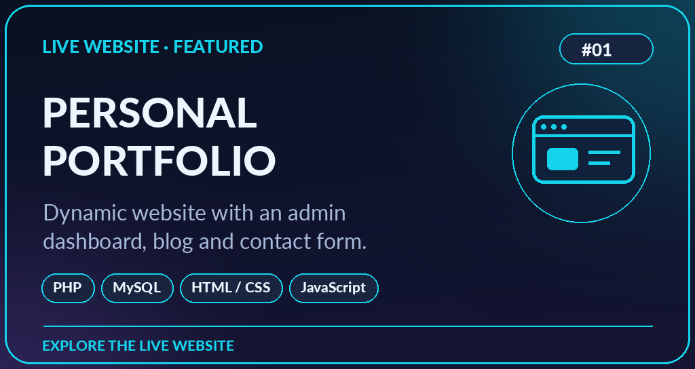
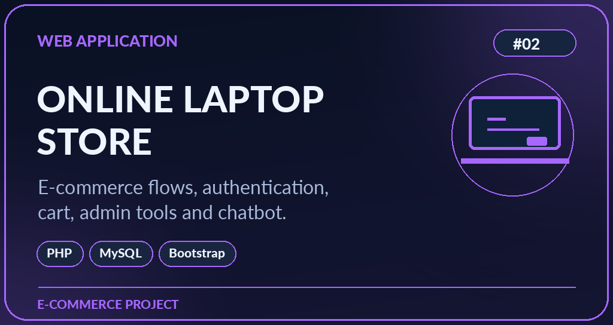
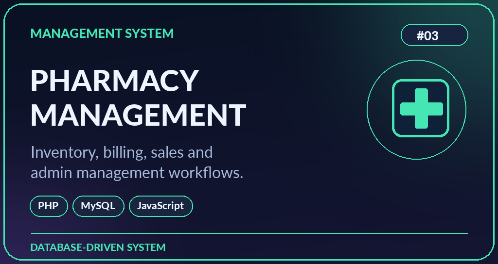
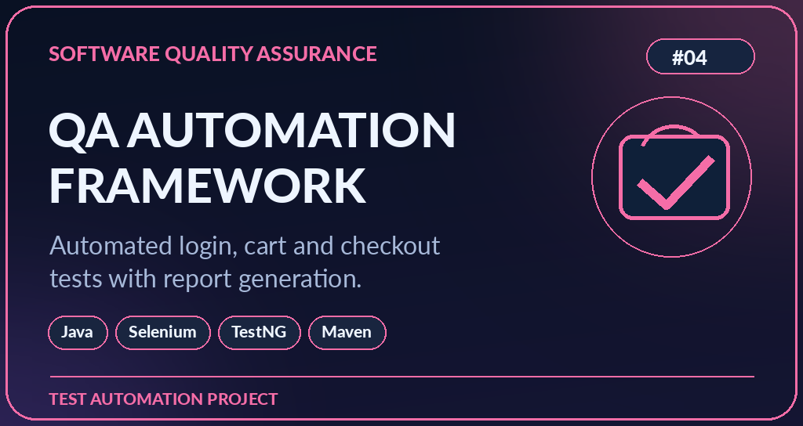
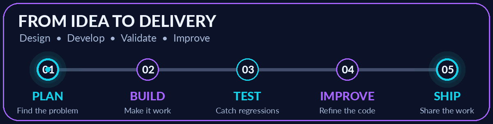
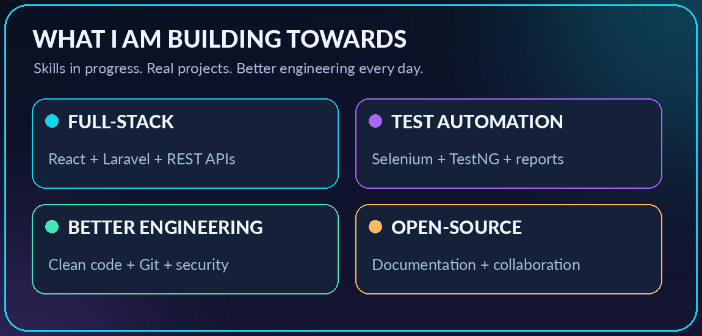
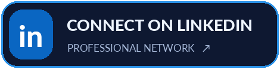

 

 

  

WEB DEVELOPMENT   SOFTWARE TESTING   QA AUTOMATION   SRI LANKA

👨‍💻 Who am I?

Hey there! I'm Mhd Aseem (A.M.M. Aseem) — an HNDIT student at SLIATE, web developer, and aspiring software professional. I love creating clean web experiences and making sure they work reliably through thoughtful testing.

🔭 Building: Responsive, database-driven websites with PHP and MySQL.

🧪 Testing: Learning and practising automation with Java, Selenium WebDriver, TestNG and Maven.

🌱 Growing into full-stack: Learning React, Laravel and API development.

🛠️ Workflow: Git, GitHub, Fork Git Client, VS Code, WAMP / XAMPP.

🤝 Beyond code: Hackathon teamwork, leadership, problem-solving and continuous learning.

🌐 Explore my full story: My portfolio website ↗

⚡ My tech universe

 

Frontend

  

Backend, Database & Testing

  

Version Control & Tools

 

PHP · MySQL · Java · Selenium WebDriver · TestNG · Maven · PHPMailer · VS Code · Fork · WAMP · XAMPP

🌱 Next chapter — React + Laravel

&nbsp;&nbsp;&nbsp;&nbsp;

 

I am learning to connect React frontends with Laravel APIs and MySQL backends.

🚀 Selected projects

A selection of web development and software testing projects — from user-facing experiences to reliable automation.

<table>
<tr>
<td width="50%" valign="top"></td>
<td width="50%" valign="top"></td>
</tr>
<tr>
<td width="50%" valign="top"></td>
<td width="50%" valign="top"></td>
</tr>
</table>

Portfolio and project descriptions reflect my portfolio and resume. Additional live demos and public source links can be added when available.

🔬 My workflow — build it, test it, improve it

I care about both how an application looks and how reliably it works.

<b>🔍 More about my development approach</b>

I start by understanding the requirement, build responsive and database-driven features, test important user journeys, improve code based on feedback, and commit changes with meaningful Git history. My PHP + MySQL portfolio also includes editable profile information, skills, projects, blog posts and contact messages.

🎯 Currently focused on

Learning deliberately • Practising consistently • Building with purpose

🤝 Let's connect

 
 

 

BUILD WITH INTENTION · TEST WITH CARE · KEEP GROWING

Thanks for visiting! ✨

