

<a href="https://mhdaseem.infinityfreeapp.com">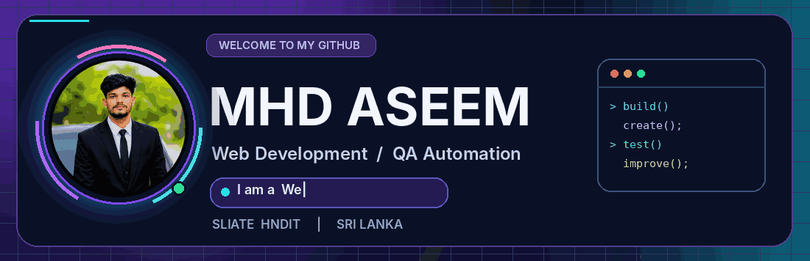</a>

 

<a href="https://mhdaseem.infinityfreeapp.com">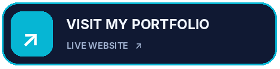</a> 
<a href="https://github.com/Aseem345?tab=repositories">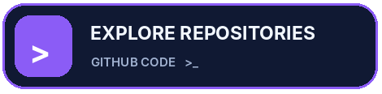</a>

  

WEB DEVELOPMENT   SOFTWARE TESTING   QA AUTOMATION   SRI LANKA

👨‍💻 Who am I?

Hey there! I'm Mhd Aseem (A.M.M. Aseem) — an HNDIT student at SLIATE, web developer, and aspiring software professional. I love creating clean web experiences and making sure they work reliably through thoughtful testing.

🔭 Building: Responsive, database-driven websites with PHP and MySQL.

🧪 Testing: Learning and practising automation with Java, Selenium WebDriver, TestNG and Maven.

🌱 Growing into full-stack: Learning React, Laravel and API development.

🛠️ Workflow: Git, GitHub, Fork Git Client, VS Code, WAMP / XAMPP.

🤝 Beyond code: Hackathon teamwork, leadership, problem-solving and continuous learning.

🌐 Explore my full story: My portfolio website ↗

⚡ My tech universe

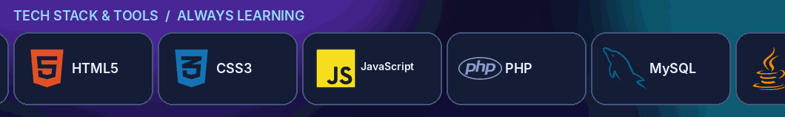

 

Frontend

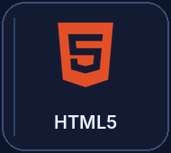
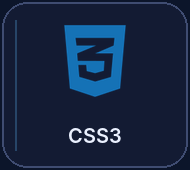
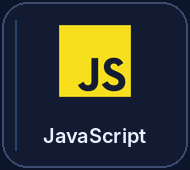
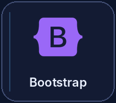
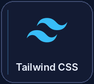

  

Backend, Database & Testing

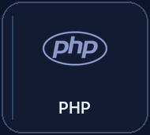
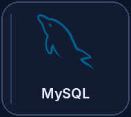
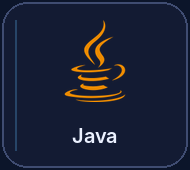
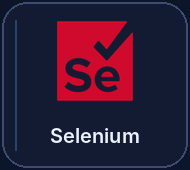

  

Version Control & Tools

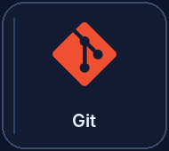
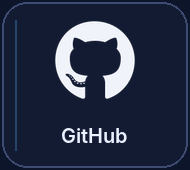

 

PHP · MySQL · Java · Selenium WebDriver · TestNG · Maven · PHPMailer · VS Code · Fork · WAMP · XAMPP

🌱 Next chapter — React + Laravel

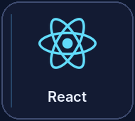
&nbsp;&nbsp;&nbsp;&nbsp;
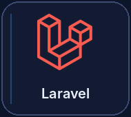

 

I am learning to connect React frontends with Laravel APIs and MySQL backends.

🚀 Things I've worked on

Project

What it covers

Technologies

🌐 My Personal Portfolio ↗

Responsive portfolio with an admin dashboard, editable content, contact form and blog features

PHP · MySQL · HTML · CSS · JavaScript

🛒 Online Laptop Store

E-commerce flows, authentication, shopping cart, admin features and chatbot integration

PHP · MySQL · Bootstrap

💊 Pharmacy Management System

Inventory, billing, sales and admin workflows

PHP · MySQL · JavaScript

🧪 QA Automation Framework

Automated login, cart and checkout test flows with reports

Java · Selenium · TestNG · Maven

These project descriptions come from my portfolio and resume. I have linked the live portfolio directly; other demos and source links can be added as they become public.

🔬 Building AND testing

I like to think beyond just making a page look good:

PLAN      → Understand the problem and design the experience
BUILD     → Make responsive interfaces and database-driven features
TEST      → Check essential flows and catch regressions
IMPROVE   → Refactor, document and learn from feedback
SHIP      → Use Git branches, meaningful commits and clear READMEs

My portfolio includes PHP + MySQL content management for profile details, education, skills, projects, achievements, blog posts and messages — a hands-on way to understand the entire application lifecycle.

🎯 What I'm focused on now

Full-stack development: React components + Laravel fundamentals + REST APIs.

Testing practice: Writing maintainable Selenium automation and test reports.

Software craftsmanship: Cleaner code, better Git practices and sensible security habits.

Open-source readiness: Better project documentation and sharing useful code.

🤝 Let's connect

🌐 Portfolio  ·  💻 GitHub Repositories  ·  💼 LinkedIn

 

BUILD WITH INTENTION · TEST WITH CARE · KEEP GROWING

Thanks for dropping by! ✨

